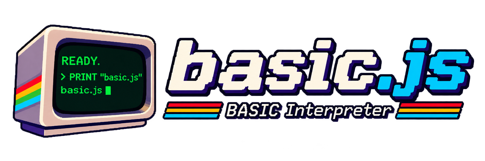

<div align="center">
  
</div>

# basic.js - nostalgia for your browser

_A little piece of 1982, running in your browser._

A browser-based **Commodore 64 BASIC V2 interpreter**, built from scratch with **TypeScript**.

Write and execute BASIC commands directly, create programs using classic line numbers and experience a little 8-bit nostalgia starting with a retro-inspired interface, authentic-looking typography, all the way to the iconic block cursor.

The interpreter also powers an interactive portfolio written in BASIC.

Check it out [here](https://www.marclang.ch).

## Table of contents

- [Features](#features)
- [Getting started](#getting-started)
  - [Prerequisites](#prerequisites)
  - [Installation](#installation)
  - [Production build](#production-build)
- [Usage](#usage)
  - [Direct commands](#direct-commands)
  - [Available commands](#available-commands)
  - [Writing and running programs](#writing-and-running-programs)
  - [Variables and arithmetic](#variables-and-arithmetic)
  - [Conditional execution](#conditional-execution)
  - [Loading BASIC programs](#loading-basic-programs)
  - [Opening links](#opening-links)
  - [Interrupting execution](#interrupting-execution)
  - [PETSCII colors and control codes](#petscii-colors-and-control-codes)
  - [basic.js extensions](#basicjs-extensions)
- [How it works](#how-it-works)
- [Testing](#testing)
- [Tech stack](#tech-stack)
- [Project scope](#project-scope)
- [Why I built this](#why-i-built-this)
- [AI Usage & Attribution](#ai-usage--attribution)

## Features

- **Interactive BASIC interpreter** - execute commands directly in the browser.
- **Line-numbered programs** - write, store, list, and run BASIC programs.
- **Control flow** - conditional statements with `IF`, `THEN`, `AND`, `OR`, and jumps with `GOTO`.
- **Variables** - numeric, integer (`%`), and string (`$`) variables, including assignment with `LET`.
- **Arithmetic evaluator** - operator precedence, negative numbers, and arithmetic expressions without JavaScript's `eval()`.
- **Interactive input** - prompt users with `INPUT` and resume execution when they respond.
- **Program loading** - load bundled `.bas` files using `LOAD`.
- **Program management** - clear variables with `CLR` or reset stored programs and variables with `NEW`.
- **Built-in help** - display a quick reference using `HELP`.
- **External links** - navigate to websites or open an email handler using `OPENLINK`.
- **Execution interruption** - stop a running program with `Ctrl+C`.
- **PETSCII output** - use `CHR$()` for C64 text colors and screen control codes.
- **Custom formatting extensions** - open and close styled output containers, set background colors, and reset formatting using extended `CHR$()` codes.
- **Retro interface** - Commodore 64-inspired typography, colors, blinking cursor, and a clearable terminal screen.
- **Automated testing** - unit and integration tests for BASIC commands and program execution.

## Getting started

### Prerequisites

- Node.js
- Vite+ (`vp`)

### Installation

Clone the repository:

```bash
git clone https://github.com/marclang64/basic.js.git
cd basic.js
```

Install dependencies:

```bash
vp install
```

Start the development server:

```bash
vp dev
```

Open the local URL displayed in your terminal.

### Production build

Build the application:

```bash
vp build
```

Preview the production build locally:

```bash
vp preview
```

The application can load different startup BASIC programs depending on whether it runs in development or production mode.

## Usage

### Direct commands

Enter BASIC commands directly into the terminal:

```basic
PRINT "HELLO WORLD"
PRINT 2+3*4
HELP
```

### Available commands

| Command    | Description                                                           |
| ---------- | --------------------------------------------------------------------- |
| `PRINT`    | Display text, values, or an empty line                                |
| `LET`      | Assign a value to a variable                                          |
| `INPUT`    | Prompt for one or more variable values                                |
| `IF`       | Evaluate a condition and optionally jump to a line or execute `PRINT` |
| `GOTO`     | Jump to a numbered program line                                       |
| `LIST`     | Display the stored program                                            |
| `RUN`      | Execute the stored program                                            |
| `LOAD`     | Load a bundled BASIC program                                          |
| `NEW`      | Clear the stored program and variables                                |
| `CLR`      | Clear stored variables                                                |
| `REM`      | Add a comment to a program                                            |
| `OPENLINK` | Navigate to an HTTP(S) URL or open a `mailto:` link                   |
| `HELP`     | Display the built-in help screen                                      |
| `EXIT`     | Return to the startup screen                                          |

`GET` is registered internally but is not functional yet, so it is not listed as an available command.

### Writing and running programs

Add line numbers to store commands as a program:

```basic
10 PRINT "HELLO WORLD"
20 INPUT "WHAT IS YOUR NAME"; N$
30 PRINT "HELLO "; N$
40 PRINT "WELCOME TO THE C64!"
```

Execute the program:

```basic
RUN
```

Use `LIST` to inspect stored program lines.

### Variables and arithmetic

Assign values with `LET` and use them in expressions:

```basic
10 LET A=10
20 LET B=A*2+5
30 PRINT B
```

Output:

```text
25
```

String variables use the `$` suffix, while integer variables use `%`.

```basic
10 LET NAME$="COMMODORE"
20 LET COUNT%=3
30 PRINT NAME$
40 PRINT COUNT%
```

### Conditional execution

Use `IF` statements to control program flow:

```basic
10 PRINT "HELLO WORLD"
20 INPUT "READ IT AGAIN? Y/N"; A$
30 IF A$="Y" THEN 10
40 IF A$="N" THEN 60
50 GOTO 20
60 PRINT "OK. BYE THEN!"
```

String comparisons are case-sensitive, as in the original BASIC V2. Conditions can also combine comparisons with `AND` and `OR`:

```basic
10 INPUT "OPEN GITHUB? (G/N)"; A$
20 IF A$="G" OR A$="g" THEN 40
30 GOTO 50
40 PRINT "USE OPENLINK TO VISIT THE REPOSITORY"
50 PRINT "READY."
```

Currently, `THEN` supports a line number or a `PRINT` statement. Other commands, including `OPENLINK`, must be placed on their own program lines.

### Loading BASIC programs

Load a bundled BASIC program into memory:

```basic
LOAD "WEBSITE"
```

Then execute it:

```basic
RUN
```

`LOAD` loads the program into memory without executing it. `RUN` starts execution.

### Opening links

Use `OPENLINK` with a quoted URL:

```basic
OPENLINK "https://github.com/marclang64/basic.js"
OPENLINK "mailto:hello@example.com"
```

HTTP and HTTPS links navigate in the current browser tab. `mailto:` links hand off to the user's configured email handler, if available. Other URL schemes are not supported.

The repository URL above reflects the current README and should be changed when the GitHub repository is renamed.

### Interrupting execution

Press **Ctrl+C** to interrupt a running program, including one waiting for `INPUT`.

### PETSCII colors and control codes

Use `CHR$()` in `PRINT` statements to change text colors or control the screen:

```basic
10 PRINT CHR$(147)
20 PRINT CHR$(28);"RED TEXT"
30 PRINT CHR$(30);"GREEN TEXT"
40 PRINT CHR$(154);"LIGHT BLUE TEXT"
```

`CHR$(147)` clears the terminal output. Color changes remain active for subsequent text until another color code is printed. The interpreter supports the C64's 16 text colors.

### basic.js extensions

basic.js uses codes beyond the original 8-bit PETSCII range (`0`-`255`) for browser-specific formatting:

| Code                    | Effect                                 |
| ----------------------- | -------------------------------------- |
| `CHR$(256)`             | Open a centered output container       |
| `CHR$(257)`             | Close the current formatting container |
| `CHR$(301)`-`CHR$(316)` | Set one of 16 background colors        |
| `CHR$(317)`             | Reset the background color             |
| `CHR$(318)`             | Reset the text color                   |
| `CHR$(319)`             | Reset both text and background colors  |

For example:

```basic
10 PRINT CHR$(256)
20 PRINT CHR$(31);CHR$(312);" WELCOME TO BASIC.JS "
30 PRINT CHR$(319)
40 PRINT CHR$(257)
50 PRINT "BACK TO NORMAL"
```

These are **basic.js extensions**, not original Commodore 64 PETSCII codes. Formatting containers can span multiple `PRINT` statements.

## How it works

The interpreter is organized into several components:

| Component                   | Responsibility                                                           |
| --------------------------- | ------------------------------------------------------------------------ |
| **Dispatcher**              | Processes entered BASIC commands and numbered program lines              |
| **Tokenizer**               | Converts BASIC expressions into typed tokens                             |
| **Command implementations** | Execute instructions such as `PRINT`, `LET`, `INPUT`, and `GOTO`         |
| **Arithmetic evaluator**    | Evaluates expressions with operator precedence and unary minus           |
| **Program storage**         | Stores numbered BASIC lines and variables                                |
| **Execution engine**        | Runs programs, handles jumps, waits for input, and supports interruption |
| **PETSCII handlers**        | Interpret character control codes and basic.js formatting extensions     |
| **DOM output**              | Renders text, colors, and formatting containers in the terminal          |

The interpreter evaluates arithmetic expressions without using JavaScript's `eval()`.

Bundled BASIC programs are stored in `.bas` files and imported as raw text through Vite+.

## Testing

Run the test suite:

```bash
vp test
```

The tests cover tokenization, arithmetic evaluation, BASIC commands, DOM output, PETSCII controls, and integration scenarios involving `RUN`, `GOTO`, `INPUT`, and Ctrl+C.

## Tech stack

- **TypeScript** - interpreter implementation
- **Vite+** - development tooling and builds
- **Vitest** - automated testing
- **HTML & CSS** - retro terminal interface

## Project scope

This project is a tribute to the Commodore 64 and an exploration of how a programming language interpreter works.

It aims to recreate the core experience of programming in **Commodore 64 BASIC V2** inside a modern web browser.

It is not a hardware emulator, and not every original BASIC V2 command or hardware-specific feature is implemented (yet).

## Why I built this

The Commodore 64 comes from an era when programming was part of the experience of using a computer.

I wanted to bring that feeling into the browser while building something more interesting than a conventional portfolio website.

Rather than simply recreating the appearance of a retro terminal, I built an interpreter that can actually execute BASIC programs.

The result is both a programming experiment and an interactive portfolio.

## AI Usage & Attribution

AI tools were used to support the creation of selected project assets and supporting materials:

- **Logo:** Generated with AI.
- **Documentation:** The README was drafted and refined with AI assistance.
- **Tests:** Test cases and implementations were created with AI assistance.

**The BASIC interpreter itself-including its tokenizer, expression evaluation, command handling, execution engine, and application logic-was designed and implemented by me.**

AI was used as a supporting tool for the materials listed above, not as the author of the interpreter's core implementation.

---

_READY._ █
